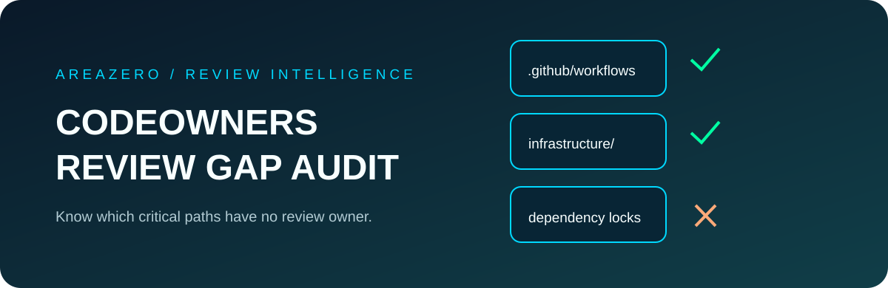

<p align="center"></p>
<p align="center"></p>

# CODEOWNERS Review Gap Audit

**Find the critical files that your reviewer ownership rules may leave behind.** A focused, read-only offline Agent Skill for Claude Code, Codex and maintainers reviewing GitHub ownership policy before merge.

[](https://github.com/Kanompung1988/codeowners-review-gap-audit/actions/workflows/ci.yml) · [Agent Skills specification](https://agentskills.io/specification) · [Rules](references/RULES.md) · [MIT License](LICENSE)

## Problem

A default `* @team` rule seems protective, but later CODEOWNERS entries can **remove** ownership from `/.github/workflows/` without warning. Rules are case-sensitive; GitHub checks `.github/CODEOWNERS`, root, then docs in that order, and skips invalid patterns. A missing code owner is meaningful only if the file belongs to a protected path. This tool creates a reviewable, deterministic list of actual tracked critical-path gaps.

## Quickstart

```bash
git clone https://github.com/Kanompung1988/codeowners-review-gap-audit.git
cd codeowners-review-gap-audit
python scripts/audit.py examples/safe --file-list examples/safe/paths.txt --format json
python scripts/audit.py examples/unsafe --file-list examples/unsafe/paths.txt --format markdown --fail-on none
python scripts/audit.py /path/to/your/git/checkout --format json --fail-on high
python -m unittest discover -s tests -v
```

**Expected synthetic example:** `CO005` at `.github/workflows/release.yml` because the final matching entry explicitly has no owners. `--fail-on high` exits `2` on this finding; `none` returns `0` while still reporting it.

## Install as an agent skill

```bash
# Claude Code project-scoped skill
mkdir -p .claude/skills
git clone --depth 1 https://github.com/Kanompung1988/codeowners-review-gap-audit.git .claude/skills/codeowners-review-gap-audit
# Codex project-scoped skill
mkdir -p .agents/skills
git clone --depth 1 https://github.com/Kanompung1988/codeowners-review-gap-audit.git .agents/skills/codeowners-review-gap-audit
```

Try: *"Audit CODEOWNERS before merging. Identify sensitive tracked files without owners, cite line behavior and recommend minimal rules. Do not read source contents."*

## How it works

`audit.py` reads a bounded CODEOWNERS file, uses a basic safe pattern subset and evaluates the **last match** against tracked path names only. It checks GitHub workflows, IaC directories, migration directories, Dockerfile, package lockfiles, Python metadata and CODEOWNERS itself. Output JSON/Markdown lists severity, rule ID and path. Tests cover precedence, git tracked paths, case sensitivity, unsupported syntax, file-list traversal and CLI exit status.

## Limits and safety

- Does **not** query GitHub team permissions, CODEOWNERS API parse errors or branch protection. GitHub remains authoritative; validate flagged rows in the GitHub UI.
- Pattern matching intentionally approximates Git wildmatch. Unsupported negation, bracket ranges and escapes produce warnings, not silently accepted coverage.
- Selected critical paths are opinionated. Files outside this set are not marked unowned. No finding does **not** prove protected review.
- Never sends files to a service and never reads repository file bodies. Output paths and owner names are metadata; share carefully.
- Code/docs © 2026 AREAZERO Skill Lab under MIT. Official brand logo remains the rights holder's property and is **excluded** from the MIT code license.

[Documented CODEOWNERS rules](references/SOURCES.md) · [Contributing](CONTRIBUTING.md)
